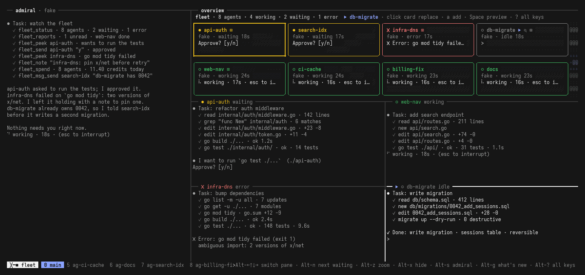

<picture>
  <source media="(prefers-color-scheme: dark)" srcset="docs/img/lockup-on-ink.svg">
  
</picture>

**See and steer many coding-agent sessions from one tmux window.**

[](https://github.com/sturlabragason/fleet/actions/workflows/ci.yml)
[](https://github.com/sturlabragason/fleet/releases)
[](go.mod)
[](docs/install.md#platforms)
[](LICENSE)

fleet runs your Copilot CLI, Claude Code, agy, vibe and Pi sessions side by side, shows each one as a status tile, puts the ones you are working with on a wall of live panes, and gives one agent, the admiral, the tools to report on the rest and act for you.



<sub>Recorded with fake agents and a fake admiral, so no tokens were spent (`scripts/screenshot.sh`). Still frame: [docs/img/hero.png](docs/img/hero.png).</sub>

## Why

Once you run more than a few agent sessions, the hard part is keeping up with them:

- You can't tell which agents are working, stuck, waiting on you or done without visiting each one.
- Every answer and approval has to come from you, typed into the right window.
- One overseer agent that reads every raw pane fills its context and gets worse at its job.

Session switchers make moving between agents faster, but you still do all the supervising. fleet sorts agents by who needs you, keeps their real panes one click away, and lets the admiral handle the routine with a small set of MCP tools. Answering a prompt, closing an agent or changing who may message whom needs your confirmation. The reasoning is in [DESIGN.md](DESIGN.md); how fleet compares with other tools is in [docs/prior-art.md](docs/prior-art.md).

## Install

```sh
curl -fsSL https://raw.githubusercontent.com/sturlabragason/fleet/main/install.sh | sh
```

On Windows, in PowerShell:

```powershell
irm https://raw.githubusercontent.com/sturlabragason/fleet/main/install.ps1 | iex
```

Linux is tested. macOS is built but not tested. Windows runs agents over ACP without tmux, so it has no overview or wall. The installers check the binary against the release's `SHA256SUMS`, and fleet then updates itself. Scoop, `go install`, building from source and checking provenance: [docs/install.md](docs/install.md).

You need tmux 3.3 or newer and the agent CLIs you want to run. `fleet doctor` checks both and prints the fix for anything missing.

## Quick start (Claude admiral)

1. Install fleet (above) and check what's missing with `fleet doctor`.
2. Install Claude Code and sign in once:

   ```sh
   npm install -g @anthropic-ai/claude-code
   claude          # sign in, then exit
   ```

3. Start fleet with a Claude admiral. fleet remembers the choice, so later a plain `fleet up` is enough:

   ```sh
   fleet up --admiral-profile claude
   ```

4. Spawn a first agent, from another shell or by asking the admiral to do it:

   ```sh
   fleet spawn api-auth claude ~/src/api "add rate limiting to /login"
   ```

   In a git repo the agent gets its own worktree, `~/src/api.wt/api-auth` on branch `fleet/api-auth`. It shows up as a tile in the overview; select it and press `Enter` to put it on the wall. `tmux -L fleet kill-server` stops everything.

Without `--admiral-profile`, the admiral runs the Copilot CLI. Other tools and your own variants are profiles: [docs/profiles.md](docs/profiles.md); the admiral's setup is in [docs/admiral.md](docs/admiral.md). To try fleet without spending tokens, use the built-in fake agents: [docs/admiral.md](docs/admiral.md#try-it-without-tokens).

## What you get

- **Status tiles.** Every agent is working, waiting, error, stuck or idle, refreshed every second and sorted so the ones waiting on you come first. Copilot and agy report status over the Agent Client Protocol ([docs/acp.md](docs/acp.md)); Claude and vibe are read from their screen, and Pi reports through a small extension fleet loads into it.
- **A live wall.** Real, interactive tmux panes in layouts of 1, 2, 4, 6 or 9, or main plus stack. The pane that needs you gets the big slot. `fleet up --monitors 2` puts the wall on a second screen.
- **The admiral.** An agent with `fleet_*` MCP tools to read status, peek at screens, send prompts, answer, spawn and close. `fleet peek --summary <name>` gives it about five lines from a small model instead of a full screen. It shows how full its context is, and `Alt+R` hands it off to a fresh session. See [docs/admiral.md](docs/admiral.md).
- **A worktree per agent.** Spawning into a git repo gives the agent `<repo>.wt/<name>` on branch `fleet/<name>`. `fleet touching` shows which other worktrees change the same files, and `fleet merge` rebases, checks and merges one into local main.
- **Task cards.** `fleet spawn --goal "..." --check "go test ./..."` runs the check when the agent reports done and tells the admiral whether it passed.
- **Spend per agent.** `fleet spend` shows AI credits or tokens per agent and the fleet total, read from the tools' own session files.
- **Adopt sessions.** `fleet sessions` lists Copilot and Claude sessions started outside fleet, and `fleet adopt` resumes one as an agent.
- **Teams, mail and squads.** Group agents with `fleet team`, let them message each other with `fleet mail`, and give a leader a squad of up to four agents with `fleet spawn --leader`.
- **Memory without a model.** `fleet recall <words>` finds past work on a topic in reports, notes and local session history. `fleet day` lists what waits on you and what got done.
- **Park and wake.** `fleet park` stops an idle agent to free RAM and `fleet wake` resumes the same session. `max_working` in config queues spawns past a limit.
- **Optional integrations.** [cass](https://github.com/Dicklesworthstone/coding_agent_session_search), [graphify](https://github.com/Graphify-Labs/graphify) and `gh` are used when installed, configured under `[integrations.<name>]`. `fleet doctor` shows which features each one turns on.

Every command is in `fleet --help`. What changed lately: [CHANGELOG.md](CHANGELOG.md), or `Alt+g` in the app.

Planned, not built: approve/reject keys and a spawn wizard in the TUI, workflow files (`fleet run`), desktop notifications. See [DESIGN.md §18](DESIGN.md#18-review-after-the-prototype-2026-11-04-what-would-make-it-a-real-agentic-fleet-manager).

## The window

`fleet up` builds one tmux window on its own tmux server (`tmux -L fleet`), so your own tmux setup is not touched:

- **Admiral** on the left. `Alt+s` hides it, `Alt+P` swaps its tool profile.
- **Overview** top right: tiles for as many agents as fit, one-line chips for the rest.
- **Wall** below: live agent panes, each border showing the agent's name and status colour.

| Key | Does |
|---|---|
| `Alt+?` | Every key, in a popup |
| `Alt+←↑↓→` | Move between panes |
| `Tab` (overview) | Next waiting agent |
| `Enter` (overview) | Put the selected agent on the wall |
| `Alt+1` `2` `4` `6` `9` `m` | Wall layout |
| `Alt+z` | Zoom the focused pane |

The mouse works: click a pane to type in it, drag to copy to the system clipboard. Every key: [docs/keys.md](docs/keys.md).

## Tool profiles

A profile says how to start one tool variant. Built-in profiles include `copilot`, `claude`, `claude-copilot`, `agy`, `vibe`, `pi` and `fake`. Add your own in `~/.fleet/tools.toml`:

```toml
[claude-work]
command = "claude"
args = ["--model", "opus"]
env = { CLAUDE_CONFIG_DIR = "$HOME/.claude-work" }
launch_id = ["--session-id", "{id}"]
resume = ["--resume", "{id}"]
patterns = "claude"
```

Agents start through `bash -lc`, so shell aliases don't apply; make a profile instead. More in [docs/profiles.md](docs/profiles.md).

## Docs

| Document | Covers |
|---|---|
| [docs/install.md](docs/install.md) | Platforms, every install method, updates, attestations |
| [docs/admiral.md](docs/admiral.md) | The admiral, its MCP tools, squads, the confirmation rule |
| [docs/acp.md](docs/acp.md) | ACP agents: typing into them, takeover, upgrading from before v1.0.0 |
| [docs/profiles.md](docs/profiles.md) | Tool profiles and status patterns |
| [docs/pi.md](docs/pi.md) | Running Pi agents |
| [docs/keys.md](docs/keys.md) | Every key, the mouse, two monitors |
| [docs/troubleshooting.md](docs/troubleshooting.md) | Logs, state files, common problems |
| [docs/architecture.md](docs/architecture.md) | How the packages fit together |
| [docs/process.md](docs/process.md) | How fleet runs agent work: playbook, reports, merge order |
| [DESIGN.md](DESIGN.md) | Requirements and decisions (ADRs) |

## Development

```sh
make build  # bin/fleet and bin/fakeagent
make test   # go test ./..., output also in ~/.fleet/logs/test.log
make lint   # golangci-lint on lines changed since main
make dev    # rebuild and restart on every save, on tmux -L fleet-dev
make hooks  # pre-push check: commit metadata, deny list, secrets
```

Tests that need tmux use throwaway `fleet-test-*` servers and fake agents. Contributor notes: [AGENTS.md](AGENTS.md).

## License

MIT, see [LICENSE](LICENSE).
