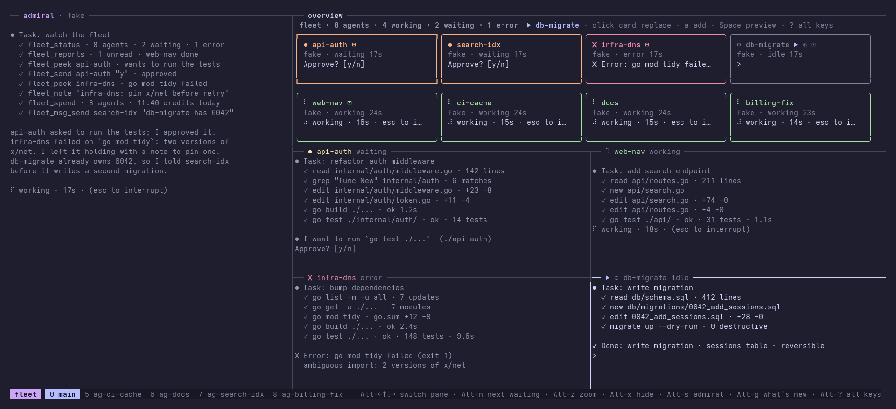
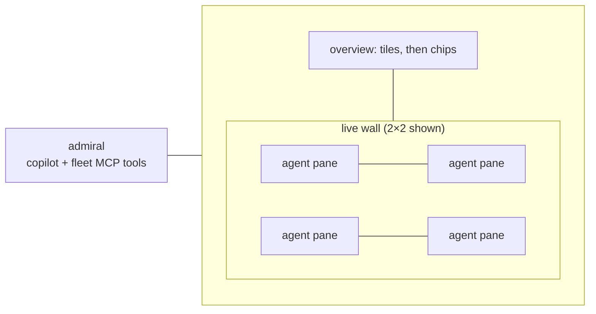

<picture>
  <source media="(prefers-color-scheme: dark)" srcset="docs/img/lockup-on-ink.svg">
  
</picture>

See and steer many coding-agent sessions (Copilot CLI, Claude Code, agy, vibe) from one tmux window, with an LLM admiral that can act on them for you.



<sub>Screenshot made with fake agents (`scripts/screenshot.sh`); the admiral pane here is also a fake agent. Animated version: [docs/img/demo.gif](docs/img/demo.gif).</sub>

## Why

Running 20–40 agent sessions at once, the terminals aren't the problem. Attention is:

- You can't tell which agents are working, stuck, waiting on you or done without visiting each terminal.
- Every answer and approval has to come from you, typed into the right window.
- A single overseer agent that reads every raw pane fills its context and gets worse at its job.

Session switchers make moving between agents faster, but you still do all the supervising. fleet puts every agent in one tmux server, shows its status as a coloured tile, puts the agents you care about on a live wall of real panes, and gives one agent, the admiral, a small set of MCP tools to report on and act on the fleet. Risky actions need your confirmation. The full reasoning is in [DESIGN.md](DESIGN.md).

## What it does today

- **Spawn** agents from tool profiles into a dedicated tmux server (`tmux -L fleet`), one hidden window per agent.
- **Status** for every agent (working, waiting, error, stuck, idle), read from the bottom of each pane with per-tool regex patterns. Polled every second.
- **Overview TUI**: coloured tiles sorted by attention (waiting agents first, longest wait first), arrow keys, mouse click, `Tab` through waiting agents.
- **Live wall**: real, interactive tmux panes for the agents you are working with. Layouts 1, 2, 4, 6, 9 and main+stack, as caps rather than fixed shapes: the grid is sized to the window so panes stay readable, and a readability floor shows fewer panes rather than unreadable ones. The pane that needs attention gets the big slot. Click a pane to make it the `▶` target and the next card you pick from the overview goes there; from the overview, `p` pins a pane so it is never evicted and `u` undoes the last replace. Waiting and failing panes stay. Processes never restart.
- **Copy out of any pane**: drag-select, double-click or triple-click copies to the system clipboard, even over an agent that asked for the mouse.
- **Adopt**: `fleet sessions` lists Copilot and Claude sessions started outside fleet, and `fleet adopt` resumes one as an agent.
- **A queue**: with `max_working` set, a spawn past the limit waits and starts when a slot frees.
- **A worktree per agent**: spawning into a git repo gives the agent `<repo>.wt/<name>` on branch `fleet/<name>`, so parallel agents never share an index. `--no-worktree` opts out.
- **Admiral**: an agent (Copilot CLI by default) in the left pane with nineteen `fleet_*` MCP tools from `fleet mcp`. It keeps a context meter, can hand off to a fresh session (`Alt+R`) and can swap its own tool profile (`Alt+P`). Unread agent reports show as a `✉` badge in the overview header and the tmux status line.
- **Cheap summaries**: `fleet peek --summary <name>` returns about five lines (what the agent is doing, what it waits for, any error) from a small model instead of a screenful of text.
- **Teams**: group agents (`fleet team create frontend teal`), then send to, show or close a whole team at once. Members are marked with a coloured `◆`.
- **Agent mail**: agents message each other with `fleet mail` or peer MCP tools. Free inside a team or a repo, otherwise one agent asks and you decide.
- **Squads**: `fleet spawn --leader <name> <profile>` makes an agent a leader, with its own tools to spawn, watch, message and close up to four agents of its own. Their reports wake the leader, which sends the admiral one summary; leaders are marked `▲` and never answer prompts, merge or push for you.
- **CLI** for scripting: `spawn`, `adopt`, `sessions`, `ls`, `send`, `peek`, `close`, `team`, `mail`, `access`, `report`, `spend`, `admiral`, `note`, `playbook`, `touching`, `merge`, `profiles`, `keys`, `changes`, `snap`, `wall`.
- **Spend**: `fleet spend` shows what each agent has cost so far and the fleet total — AI credits for Copilot agents, tokens for Claude — read from the agents' own session files, never from a model.
- **Fake agents** that cycle through states and print scripted work (reads, edits, test runs), so you can try everything without spending tokens. `fleet send <name> "!wait"` (or `!work`, `!error`, `!done`) holds one in a chosen state, which is how the screenshot above is composed.

Planned, not built yet: park/wake to save RAM, tool hooks instead of screen scraping, a spawn wizard, approve/reject keys in the TUI, notifications. See [Roadmap](#roadmap).

## Requirements

- Linux (the only platform tested).
- tmux. Developed and tested with tmux 3.8.
- Go 1.26.10 or newer to build (see `go.mod`).
- The agent CLIs you want to run (`copilot`, `claude`, `agy`, `vibe`) on your login `PATH`. Not needed for fake agents.

## Install

```sh
go install github.com/sturlabragason/fleet/cmd/fleet@latest
```

or from a checkout:

```sh
make build      # bin/fleet and bin/fakeagent
make install    # symlink bin/fleet to ~/.local/bin/fleet
```

The admiral needs no setup: `fleet up` passes the MCP server (`fleet mcp`) to it on the command line, and its rules travel as the server's instructions. Its working directory is `supervisor/` next to the binary when you build from a checkout, your home directory otherwise; `FLEET_ADMIRAL_DIR` overrides it.

## Quickstart (fake agents, no tokens)

```sh
make build
export PATH=$PWD/bin:$PATH
fleet up --admiral-profile fake --no-attach   # fake admiral too, no tokens
for n in api-auth web-nav infra-dns docs; do fleet spawn --fake $n; done
fleet ls
tmux -L fleet attach -t fleet:main
```

In the overview, select a tile and press `Enter` to put it on the wall. Click into a wall pane and type `y` to answer its prompt. `Alt+4` picks a 2×2 wall.

Drop `--admiral-profile fake` to get a real Copilot CLI admiral. To stop everything: `tmux -L fleet kill-server`.

```text
$ fleet ls
NAME         PROFILE  STATUS   FOR  PANE  LAST LINE
api-auth     fake     working  3s   %2    ⠇ Thinking… step 8 of refactor auth middleware (esc to i
web-nav      fake     waiting  11s  %3    Approve? [y/n]
```

## Screen layout

`fleet up` builds one tmux window, `fleet:main`:



- **Admiral** (left, 90 columns, 64 below 220 columns wide). `Alt+s` hides it, `Alt+S` moves it to the other side, `Alt+R` resets it, `Alt+P` swaps its profile.
- **Overview** (top right, 14 rows). Tiles for as many agents as fit, one-line chips for the rest. `Alt+c` switches to chips only.
- **Wall** (below). Live agent panes. Each pane border shows the agent's name and status in its status colour. `fleet up` starts `fleet watch`, which keeps those borders, `fleet ls`, the board and the admiral's view agreeing within about a second whether or not the overview is open.
- Agents not on the wall live in hidden windows `ag-<name>`.

All geometry is in [`internal/layout`](internal/layout/config.go).

## Keys

**Press `Alt+?` anywhere in the fleet window for a popup with every key**, grouped by area (panes, wall, admiral, overview). Any key closes it. In the overview, `?` shows the same list; `q`, `Esc` or `?` closes it. `fleet keys` prints it in a terminal. The status line at the bottom shows the most used keys in plain words.

Overview (when the overview pane has focus):

| Key | Action |
|---|---|
| `←` `↑` `↓` `→` / `h` `j` `k` `l` | Move between tiles |
| `Tab` | Next waiting agent (longest wait first) |
| `Enter`, left click | Put the selected agent on the wall |
| `x` | Take the selected agent off the wall |
| `1` `2` `4` `6` `9` `m` | Wall layout |
| `g` | What's new in fleet |
| `R` / `P` | Reset the admiral / pick its profile |
| `?` | Show all keys |
| `q`, `Ctrl+C` | Quit the overview (`fleet up` restarts it) |

Anywhere in the fleet window (tmux bindings, no prefix; only on the `fleet` server):

| Key | Action |
|---|---|
| `Alt+←↑↓→` | Move between panes |
| `Alt+z` | Zoom the focused pane |
| `Alt+x` | Take the focused wall pane off the wall |
| `Alt+1` `2` `4` `6` `9` `m` | Wall layout |
| `Alt+s` / `Alt+S` | Hide/show the admiral / move it to the other side |
| `Alt+R` / `Alt+P` | Reset the admiral to a fresh chat / pick its profile |
| `Alt+g` | What's new in fleet |
| `Alt+c` | Overview: tiles or chips only |
| `Alt+o` | Jump to the marked pane |
| `Alt+?` | Show all keys in a popup |

Mouse is on: click a pane to type in it, drag borders to resize, scroll for history. Details and planned keys: [docs/keys.md](docs/keys.md).

## Tool profiles

A profile says how to start one tool variant. Built-ins: `copilot`, `claude`, `agy`, `vibe` and `fake`. Add or override profiles in `~/.fleet/tools.toml`:

```toml
[claude-work]
command = "claude"
args = ["--model", "opus"]
env = { CLAUDE_CONFIG_DIR = "$HOME/.claude-work", CLAUDE_CODE_SUBAGENT_MODEL = "sonnet" }
launch_id = ["--session-id", "{id}"]
resume = ["--resume", "{id}"]
patterns = "claude"
```

```sh
fleet profiles
fleet spawn api-auth claude-work ~/src/api "add rate limiting to /login"
```

Agents start through `bash -lc`, so shell aliases don't apply; make a profile instead. More in [docs/profiles.md](docs/profiles.md) and [examples/tools.toml](examples/tools.toml).

## The admiral and its MCP tools

`fleet up` starts the admiral under the `copilot` profile unless you say otherwise (`--admiral-profile NAME`, `$FLEET_ADMIRAL_PROFILE`, an `[admiral]` entry in your config, or `Alt+P` while running). It talks to `fleet mcp`, a stdio MCP server, with these tools:

| Tool | What it does |
|---|---|
| `fleet_status` | All agents: status, wall, age, spend so far, what it waits for; ends with the fleet total |
| `fleet_peek` | Last N lines (default 20, max 80) of one agent's screen |
| `fleet_send` | Send a prompt to an agent |
| `fleet_answer` | Answer a y/n prompt, a numbered option or an option by `label`. Needs `confirmed=true` |
| `fleet_spawn` | Start an agent from a profile (`effort` sizes its playbook: `light`, `standard`, `pro`) |
| `fleet_profiles` | List profiles |
| `fleet_close` | Stop an agent. Needs `confirmed=true` |
| `fleet_wall` | Show/hide an agent on the wall, or set the layout |
| `fleet_sessions` | List Copilot/Claude sessions started outside fleet |
| `fleet_adopt` | Resume one of those sessions as an agent |
| `fleet_note` | Save a note to `~/.fleet/decisions.log`; `pin` keeps it in every brief |
| `fleet_brief` | Handoff + recent notes + status, for a fresh admiral |
| `fleet_handoff` | Write a handoff and restart the admiral fresh |
| `fleet_team` | List, create or change teams; send, show, hide or close one |
| `fleet_reports` | What agents reported (done, blocked, question, progress) |
| `fleet_access` | Who may message whom |
| `fleet_access_decide` | Grant, deny or revoke that. Needs `confirmed=true` |
| `fleet_admiral_profile` | Show or swap the admiral's own tool profile |
| `fleet_info` | One agent's facts: status, git state, session, context fill, spend so far |

A leader agent (`fleet_spawn` with `leader=true`, or `fleet spawn --leader`) gets a squad-scoped set of its own: `fleet_squad_spawn`, `fleet_squad_profiles`, `fleet_squad_status`, `fleet_squad_info`, `fleet_squad_peek`, `fleet_squad_send`, `fleet_squad_reports` and `fleet_squad_close`. Each refuses any agent the leader did not spawn, and none of them can answer a prompt: that escalates to the admiral and to you. `[squad] max_members` (4) and `max_depth` (1) cap it.

The admiral must ask you before it answers a prompt, closes an agent or changes who may message whom. See [docs/admiral.md](docs/admiral.md).

## Files and logs

| Path | What |
|---|---|
| `~/.fleet/` | State dir. Override with `FLEET_HOME`. |
| `~/.fleet/board.json` | One entry per agent: profile, dir, pane, status, last line |
| `~/.fleet/events.jsonl` | Status transitions |
| `~/.fleet/status/<name>.json` | What an agent's own hooks last said about it (Claude: `Stop`, `Notification`, …) |
| `~/.fleet/watch.json` | Heartbeat of `fleet watch`, the process that keeps status live |
| `~/.fleet/tools.toml` | Your profiles |
| `~/.fleet/patterns.toml` | Your status patterns |
| `~/.fleet/decisions.log` | Notes the admiral kept for you |
| `~/.fleet/worker.md` | Extra playbook text prepended to every spawn prompt, at every effort level (`fleet playbook [--effort light\|standard\|pro]`) |
| `~/.config/fleet/config.toml` | Local preferences, never committed: starting mode (`mode = "auto"` runs every agent without permission prompts, whatever its tool), extra tool args, prompt auto-submit, `theme` (`catppuccin`, `stealth`, `neon-drive`, `phosphor`, `graphite`: set it, run `fleet up` again, agents keep running). `$FLEET_CONFIG` overrides the path; see [`examples/config.toml.example`](examples/config.toml.example). |
| `~/.fleet/logs/fleet.log` | Everything fleet does, one `component=` per line |

See [docs/troubleshooting.md](docs/troubleshooting.md).

## Development

```sh
make test   # go test ./..., never fails the build; output also in ~/.fleet/logs/test.log
make dev    # tmux -L fleet-dev: rebuild, test and restart the TUI on every save (needs watchfiles)
make hooks  # pre-push check: commit emails, home paths, secrets (scripts/check-public.sh)
```

Tests that need tmux use throwaway `fleet-test-*` servers. Architecture: [docs/architecture.md](docs/architecture.md). Contributor notes: [AGENTS.md](AGENTS.md).

## Roadmap

Shipped so far: fake agents, scraped status and the overview; the live wall (screen-sized grid, status-aware eviction, a readability floor, pinning, a `▶` target slot and undo); `fleet adopt` and `fleet sessions`; the admiral's MCP server with handoff, notes, a context meter and profile swap; teams; agent mail with access control; the worker playbook and agent reports with a `✉` badge; a git worktree per agent on spawn; copy to the system clipboard from any pane; `fleet peek --summary` from a cheap model; and `fleet snap`, which turns a misread screen into a test fixture (Claude, agy and vibe read properly because of it).

In progress:

- Task cards on spawn (goal, done-check, result file) and a result file per agent (`result.md`, or `result-<name>.md` in a shared dir)
- Park/wake with resume by session ID, a live cap and a RAM guard
- Spend per agent on the tile, with an optional per-task cap
- A stuck rule: same error twice, or no progress for N minutes

Planned:

- Approve/reject and a spawn wizard in the TUI
- Tool hooks (Claude Code, Copilot) instead of screen scraping
- Workflow files (`fleet run plan.yaml`): tasks with dependencies, fanned out and back in
- Auto-slotting the longest-waiting agent, saved walls, desktop notifications
- tmux control-mode events instead of polling; `fleet doctor`

The long version, with reasoning, is [DESIGN.md §18](DESIGN.md#18-review-after-the-prototype-2026-11-04-what-would-make-it-a-real-agentic-fleet-manager).

## License

MIT, see [LICENSE](LICENSE).
