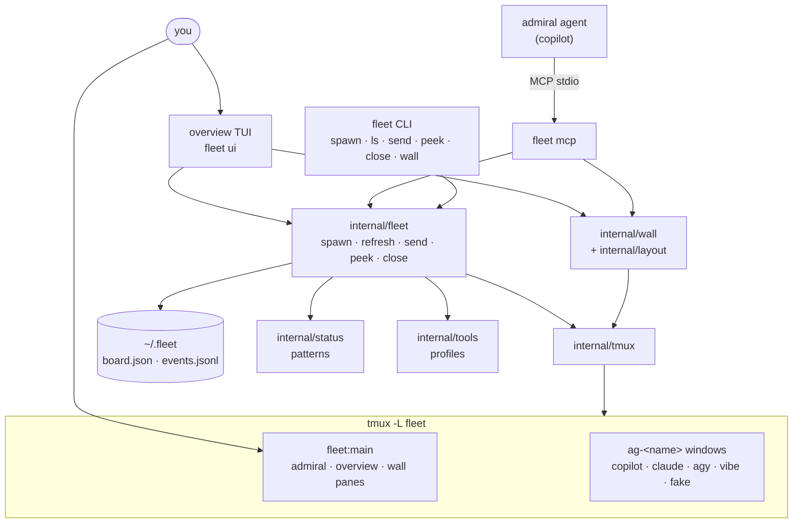

# Architecture

A short version of [DESIGN.md](../DESIGN.md), limited to what is built. Requirements are in DESIGN.md §0, decisions (ADRs) in §14.

## Principles

- **tmux does the work** (ADR-1). Every agent is a pane on a dedicated tmux server, `tmux -L fleet`. Agents keep running if the TUI or the admiral crashes or restarts.
- **One binary, two front ends.** The `fleet` binary is the CLI, the overview TUI and the MCP server. You and the admiral go through the same operations.
- **Live panes are drawn by tmux** (ADR-3). The wall is real tmux panes moved in with `join-pane` and out with `break-pane`. The TUI only draws small tiles.
- **State on disk and in tmux** (ADR-4). `~/.fleet/board.json` plus pane options (`@fleet_agent`, `@role`, `@fleet_status`). The admiral can be thrown away.
- **Scrape first, hooks later** (ADR-7). Status comes from regex patterns on the bottom of each pane.
- **Data, not code**, for anything tool-specific: profiles in `tools.toml`, patterns in `patterns.toml`.

## Components

| Package | Job |
|---|---|
| `cmd/fleet` | CLI commands, `fleet up` (builds the main window, sets tmux options and key bindings), TUI wiring |
| `cmd/fakeagent` | Stand-alone fake agent (`fleet fakeagent` is the same thing) |
| `internal/fleet` | The only place that combines tmux, profiles, status and board |
| `internal/tmux` | Runs `tmux -L <socket>`: spawn, capture, paste (bracketed, via buffers), panes, options |
| `internal/status` | Classifies pane text with per-tool patterns |
| `internal/tools` | Profiles: built-ins merged with `~/.fleet/tools.toml`, argv building |
| `internal/board` | `board.json` with a file lock and atomic rename; `events.jsonl` |
| `internal/wall` | Which panes are on the wall, least-recently-used eviction, admiral/overview toggles. State lives in tmux options. |
| `internal/layout` | All pane geometry: sizes, presets, layout strings |
| `internal/ui` | Bubble Tea overview: tiles, chips, keys, mouse (bubblezone) |
| `internal/mcp` | Minimal MCP server (JSON-RPC over stdio) and the `fleet_*` tools |
| `internal/supervisor` | The admiral's memory on disk: handoff, notes, `decisions.log`, session id |
| `internal/team` | Named, coloured agent groups in `teams.json` |
| `internal/mail` | Agent-to-agent mailbox and the access grants that gate it |
| `internal/sessions` | Finds Copilot and Claude sessions on disk, for `fleet adopt` |
| `internal/playbook` | The standard process rules prepended to every spawn prompt |
| `internal/worktree` | Other git worktrees of a repo and the files each one touches |
| `internal/keys` | The one registry of hotkeys, for tmux, the TUI, `fleet keys` and the docs |
| `internal/whatsnew` | Reads the embedded `CHANGELOG.md` for `Alt-g` |
| `internal/prefs` | Local, never-committed spawn preferences |
| `internal/theme` | The palette shared by the TUI and the tmux chrome |
| `internal/conf` | Small TOML-subset parser for the data files |
| `internal/fake` | Fake agent state machine: working → waiting / error / idle |
| `internal/logx` | slog to `~/.fleet/logs/fleet.log` with a `component` attribute |
| `internal/acp` | Client for the Agent Client Protocol (JSON-RPC 2.0 over stdio), ADR-74 |
| `internal/acphost` | `fleet acp-host`: runs one ACP agent in its pane and draws its conversation, ADR-76 |
| `internal/adr` | Hands out ADR numbers atomically to parallel agents |
| `internal/companion` | The contract for companion CLIs fleet calls (cass, gh, rsync, ssh, clipboard, terminal): lookup, `off`, version floor, timeout, install hint, doctor line (ADR-126) |
| `internal/recall` | `fleet recall` and `fleet day`; the cass adapter (ADR-119) |
| `internal/summary` | Short summaries of an agent's screen through a model CLI (ADR-40) |
| `internal/spend` | What an agent has cost, from its tool's session files (ADR-46) |
| `internal/usage` | The status-line usage bar |
| `internal/trust` | Pre-marks a directory trusted in an agent tool's own config (ADR-47) |
| `internal/routes` | The user's request routes (ADR-120) |
| `internal/rexec` | `fleet exec`: rsync a worktree to a build host and run a command there over ssh (ADR-107) |
| `internal/update` | Self-update from GitHub releases, checksum and attestation (ADR-103) |
| `internal/watch` | The background watcher that keeps status fresh and does housekeeping |
| `internal/web` | `fleet web`, the browser front end (ADR-66) |
| `internal/park` | Which agents may be parked, and in what order |
| `internal/proc` | Finds and stops process trees through `/proc` (ADR-122) |
| `internal/netwatch` | Whether the model APIs are reachable |
| `internal/jsonx` | Keeps unknown JSON keys across a read-modify-write (ADR-62) |
| `internal/legacy` | Paths renamed by ADR-26, kept working |
| `internal/sysx` | The few OS calls that differ between Unix systems |
| `internal/testenv` | Fails a test run that leaves tmux servers or processes behind (ADR-83) |

## Status loop

Every second the overview (and every `fleet ls` or `fleet_status`) runs `Refresh`:

1. List panes on the `fleet` server and match them to board entries by `@fleet_agent`.
2. Capture each pane, hash it, keep the last line.
3. Classify with the agent's pattern set; no match but changed text counts as working; the same error banner twice in a row, or working with no screen change for `stuck_after` (default 10m), is stuck (ADR-45); dead process is error; missing pane is gone.
4. On a change, write the board, append to `events.jsonl`, log it, and set `@fleet_status`, `@fleet_color` and `@fleet_glyph` on the pane so the tmux border shows the status.

## Not built yet

Park/wake and the RAM cap (§7), summaries (§6.2), hooks and control-mode events (ADR-7), agent cards (§3), approval cards in the TUI (ADR-9). See the README roadmap.
